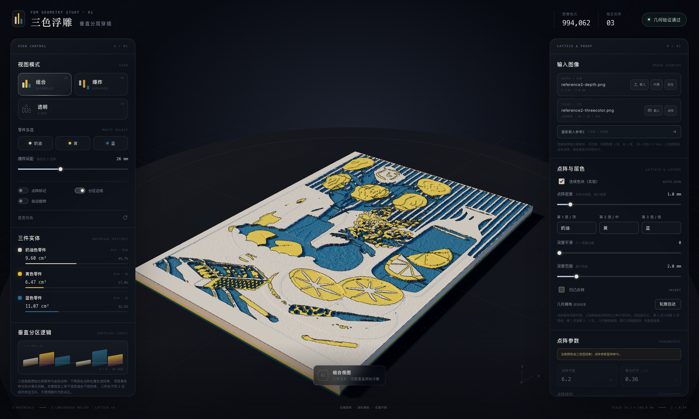
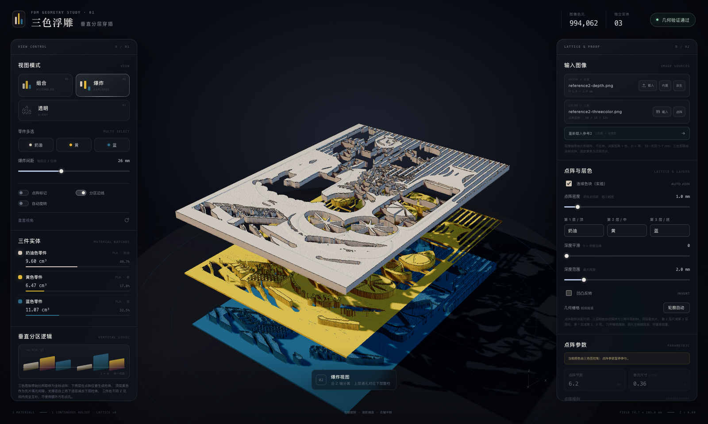
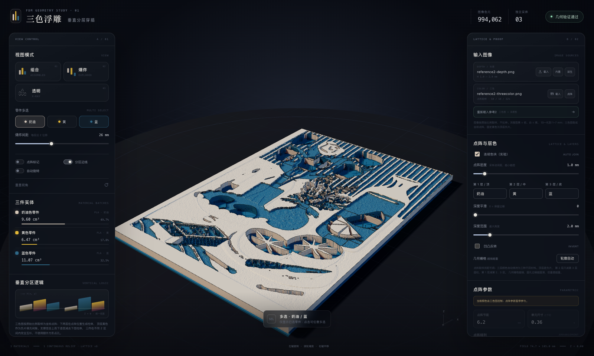

# 三色浮雕 · 三色画布 / 原图 RGB 点阵

> 共享工具链：`~/Documents/RooPlayground/README.md`

## 概览

- GitHub：https://github.com/Logic2501/tricolor-relief
- Pages：https://logic2501.github.io/tricolor-relief/

浏览器端交互式原型：三色图案 + 深度图 → 三件可独立打印、体积严格互斥的浮雕。

当前版本：

- **画布/浮雕底座尺寸严格由三色参考图决定**；载入新三色图后立即按原图比例调整。
- 深度图和派生深度只改变高度场，不再改变画布尺寸。
- 三色设置直接取**当前原图的 RGB**（允许滤波），不再固定使用旧调色板。
- 三色图和深度图都按 cover 取样，不拉伸；点阵与图像坐标轴对齐，默认无旋转。
- 几何栅格可调：`轮廓自动 / 0.30 / 0.25 / 0.20 / 0.15 / 0.10 mm`。
- 深度平滑可调：`0–6` 次，`0` 保留边缘；默认 `0`。
- 深度范围可调：`1–8 mm`，默认 `2.0 mm`。
- 凹凸反转开关。
- 实验模式「连续色块」默认开启：不再把连续色块打散成点阵，自动桥接顶层/中层以保证三件连通。
- 默认层序：奶油 / 黄 / 蓝（从参考2三色图 RGB 采样）；三层颜色可调整。
- 默认深度范围 `2.0 mm`，凹凸反转关闭。
- 第 1 层为负片，减第 2、3 层圆点；第 2 层只减第 3 层；第 3 层完整。
- 组合与爆炸共享同一组网格；零件多选显示。
- 「派生」深度基于**当前载入的三色图**生成，不使用旧静态深度。

## 预览



| 爆炸视图（圆形孔/柱） | 多选显示 |
| --- | --- |
|  |  |

层色调整示例：


## 画布、RGB 与坐标轴

- 载入三色图时，以长边 `105 mm` 计算宽高比，并按当前几何栅格取整。
- 当前默认是裁切后的参考2 → 画布 **74.7 × 105.0 mm**，几何栅格 **841 × 1182**
  （`0.09 mm`，轮廓自动）。
- 再载入深度图或点击「派生」不会改变这个画布；深度图按 cover 适配。
- 点阵采样行列严格沿模型 X/Y 轴；默认旋转为 `0°`。
- 三层颜色直接从当前原图提取：
  - 按黄色 / 品红 / 青蓝三个色相族统计；
  - 每个族用粗分箱直方图 + 分箱平均滤波，避开纸白/背景；
  - 当前默认图提取结果：`#d4c7b8 / #e2b737 / #2e6887`（奶油 / 黄 / 蓝）。
- 提取出的 RGB 同时更新 3D 材质、图例、色块和 CSS 变量。

## 点阵、密度与几何栅格

- 点阵密度滑杆：`0.8 – 3.0 mm`，默认 `1.0 mm`；连续色块模式下禁用。
- 圆点：`dx² + dy² ≤ r²` 圆形遮罩，不是方形单元格。
- 三层颜色：三个下拉框，自动保持三色不重复；顶层颜色改变表面背景/负片。
- 几何栅格：`轮廓自动 / 0.30 / 0.25 / 0.20 / 0.15 / 0.10 mm`，默认 `轮廓自动`。
  - 实测 `0.15 mm` → `608 × 700` 栅格，三件仍连通、重叠为 0。
  - `0.10 mm` 更细，但构建更重。

**关于菱形**：`1-3-5-3-1` 是圆在低分辨率栅格上的离散边界。默认轮廓自动会给出 `0.09 mm`
已减轻，但仍是栅格化圆孔/柱；放大后仍会有台阶。完全消除需要解析圆柱 + 布尔差集。

## 深度平滑

- 控件范围 `0–6` 次，默认 `0`。
- `0` 直接使用归一化后的深度数据，保留物体边缘；适合参考2这种有清晰轮廓的图。
- 次数越大越平滑，适合去除灰度概念图中的阴影/噪点。
- 平滑只作用于深度高度场，不改变三色图、点阵或几何栅格。

## 实验模式：连续色块

参考2的三色图里，三种颜色本身是连续色块（尤其是奶油底色）。

- 连续色块模式默认开启；直接把每个几何栅格取为最近的三色图中的颜色；
- 不再把所有下色块打成 1.0 mm 圆点；
- 若顶层负片或中层支撑被切成多个连通块，自动用最短栅格桥接，
  保证三件仍可打印；
- 关闭该模式可回到点阵/圆柱实验。

连续模式默认实测：色块岛 `1 / 244 / 534`，三件仍全部连通，重叠 `0.000 cm³`。

## 三层几何

`3 × 0.6 = 1.8 mm` 预留连接层：

| 层 | 颜色 | 支撑板 | 圆柱 |
| --- | --- | --- | --- |
| 1（顶） | 默认奶油 | 负片：全层减第 2、3 层圆点 | 无 |
| 2（中） | 默认黄 | 全层减第 3 层圆点 | 到 Z=0 的第 2 层柱 |
| 3（底） | 默认蓝 | 完整底板 | 到 Z=0 的第 3 层柱 |

三件在预留层内互补，重叠体积 `0.000 cm³`。

## 从当前三色图派生深度

`src/depth-from-color.ts`：

1. 按当前三层颜色角色给源图分类：顶色低、中层色中、底层色高。
2. 三次宽箱式模糊，把网点结构平滑为连续高度场。
3. 归一化为 8-bit 深度图。

「派生」按钮直接读取 `currentColourImageData`；不读取旧的
`relief_depth_derived.png`，也不基于参考2的静态灰度图。派生后画布保持
三色图比例。

参考2.jpeg 的多模态判读与三色网点建议：[docs/reference2-analysis.md](docs/reference2-analysis.md)。

参考意见已存档、暂未执行：[docs/reference-opinion-20261113.md](docs/reference-opinion-20261113.md)。

## 参考2 处理包

已裁剪 `参考2.jpeg` 的外圈白边，输出到项目内专用目录：

- [reference2/reference2-original.jpeg](reference2/reference2-original.jpeg)：原图 1600×1600
- [reference2/reference2-cropped.png](reference2/reference2-cropped.png)：裁切原图 841×1182
- [reference2/reference2-threecolor.png](reference2/reference2-threecolor.png)：严格三色、灰度边缘增强、原裁切分辨率 841×1182
- [reference2/reference2-depth.png](reference2/reference2-depth.png)：裁切图的亮度派生深度 841×1182
- [reference2/reference2-package.zip](reference2/reference2-package.zip)：以上文件打包

三色取色完全从裁切图 RGB 采样（k-means k=3，带中值滤波），不是从旧品红/青色通道推导：

- `#e3b737`
- `#d4c8b9`
- `#2f6887`

唯一 RGB 数量已校验为 3；另存三色无边缘版 `reference2-threecolor-flat.png`。
边缘增强用裁切图的亮度/深度梯度，阈值 40，边缘像素使用最暗的调色板颜色，恢复浅色物体轮廓和细线。详细说明见
[reference2/README.md](reference2/README.md)。

### 轮廓自动分辨率

几何栅格新增 **「轮廓自动」**：

- 根据当前三色图的原始像素尺寸，把长边映射到 105 mm；
- 取接近一像素一格的栅格，上限 120 万单元；
- 载入裁切后的参考2三色图（841×1182）时：
  - 画布 **74.7 × 105.0 mm**
  - 几何栅格 **841 × 1182**，单元约 **0.09 mm**
  - 与三色图/派生深度同分辨率，轮廓可辨认。

载入方式：
1. COLOR / 三色：`reference2/reference2-threecolor.png`
2. DEPTH / 灰度：`reference2/reference2-depth.png`
3. 深度平滑设为 `0` 可保留边缘；画布保持三色图的竖幅比例。

注意：当前三色点阵默认 1.0 mm 点距，但仍是点阵/柱体表示，不是连续色块，因此 app 内表面不会像素级复刻三色图；
本包用于先观察裁切、三色和深度数据本身。

## 验证口径

- 浮雕本体：三角化顶面（不含 1.8 mm 支撑层）的体积。
- 连接层：三块支撑板 + 所有圆点柱的体积。
- 体积互斥：支撑板扣除圆点栅格，柱填充同一栅格，重叠为 0。
- 连通性：顶层负片、中层支撑板、底层完整板连通。
- 色域覆盖：每个几何栅格唯一归属一种颜色。
- 顶面偏差：随机采样点与深度场比较。

默认实测（裁切参考2 + 连续色块，画布 74.7 × 105.0 mm，几何栅格 0.09 mm，深度范围 2.0 mm）：

| 项目 | 结果 |
|---|---|
| 画布尺寸 | 74.7 × 105.0 mm |
| 几何栅格 | 841 × 1182 |
| 浮雕本体体积 / 三件本体合计 | 13.02 / 13.02 cm³ |
| 连接层体积 | +14.12 cm³ |
| 总打印体积 | 27.14 cm³ |
| 原图提取 RGB | #d4c7b8 / #e2b737 / #2e6887 |
| 色块岛（奶油 / 黄 / 蓝） | 1 / 244 / 534 |
| 连接后实体 | 1 / 1 / 1 |
| 三件体积重叠 | 0.000 cm³ |
| 实际面积比 | 49.7 / 17.8 / 32.5 % |
| 顶面最大 / RMS 偏差 | 0.118 / 0.010 mm |

深度源分辨率 `410 × 495`（约 `0.21 mm/px`）；几何栅格细于源数据时，
高度场是插值/平滑结果，因此表面会比栅格看起来更平滑。这是源数据限制，
不是顶面网格分辨率不一致。

## 项目结构

```
index.html              界面（密度、三层颜色、几何栅格、派生深度）
public/                 参考2默认三色图与深度图
src/image-mapping.ts    原比例 cover 映射
src/color-map.ts        圆形点阵遮罩、密度、顶色
src/palette.ts          从三色图提取实际 RGB
src/depth-from-color.ts 从当前三色图派生深度
src/connectors.ts       三层支撑、圆点柱、互斥体积
src/main.ts             图像载入、画布、栅格/密度/层色、重建
src/relief.ts           深度场、内置高度场、平滑、体积采样
src/parts.ts            浮雕网格、色岛边界、验证
src/viewer.ts           Three.js 场景、按需渲染、多选、爆炸
src/config.ts           可变尺寸/栅格、运行时三色
scripts/capture.mjs     无头 QA
docs/                   截图、参考意见存档
backups/                版本快照
```

## 性能与空闲行为

- 渲染器已改为**按需 requestAnimationFrame**：没有交互、没有自动旋转、没有相机/零件过渡时不再出帧。
- 页面隐藏（`visibilitychange`）时取消当前帧；恢复可见时再请求一帧。
- 页面关闭（`pagehide`、非 bfcache）时：
  - 取消动画帧；
  - 断开 ResizeObserver；
  - 释放几何、材质、WebGL renderer；
  - 清除待执行的 rebuild timer。
- 无 `setInterval`；几何重建会 dispose 旧 geometry。
- 实测（无头 Chromium，空闲 5 秒）：`TaskDuration` 增量约 `0.0005 s`，JS 脚本增量 `0.0000 s`；
  `Page.setWebLifecycleState(frozen)` 3 秒增量约 `0.0004 s`。没有后台计算循环。

## 备份

- 本机备份目录：`backups/`（已在 `.gitignore` 中，不随仓库上传）
- 当前版本：`backups/tricolor-relief-continuous-20261113.tar.gz`
- 备份不包含 `node_modules`、`dist`、`tmp`。

## 当前状态

- 已完成：三色图驱动画布、原图 RGB 提取、轴对齐点阵、几何栅格可调、
  密度/层色可调、当前色图派生深度、多选、体积互斥。
- 已知限制：
  - 圆孔/柱是栅格化，不是解析圆柱面；放大有台阶。
  - 深度源分辨率固定，细于源数据的栅格只是插值/平滑。
  - 连接层增加 1.8 mm 高度，成品不是单一平底。
  - 同一零件内部顶面/柱/板仍以重叠壳表示；生产前建议按零件并集。
  - 剖切入口冻结隐藏。

## 部署

- 构建：`npm run build`
- Pages：GitHub Actions，见 `.github/workflows/pages.yml`
- 仓库：https://github.com/Logic2501/tricolor-relief
- Pages 地址：https://logic2501.github.io/tricolor-relief/
- 当前本地预览：`http://127.0.0.1:5188/`
- 默认站点路径：仓库根目录；Vite `base: './'` 以适配 GitHub Pages 子路径。

